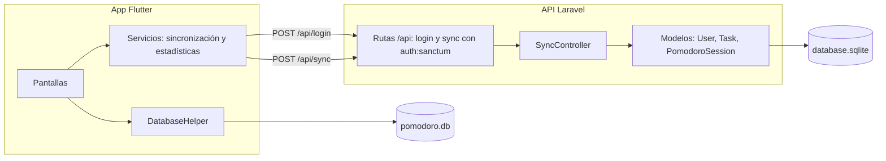

# 2. Diseño arquitectónico

El sistema es cliente-servidor con enfoque offline-first. El teléfono guarda todo en SQLite y el servidor recibe los datos por sincronización. El estilo se describe con las vistas 4+1 de Kruchten y con las decisiones registradas en `adr/`.

## Vistas 4+1

Cada vista responde a la pregunta de un interesado, como sugiere ISO/IEC/IEEE 42010.

| Vista | Pregunta que responde | Elementos | Dónde está |
| --- | --- | --- | --- |
| Lógica | ¿Qué funciones ofrece? | Temporizador, tareas, estadísticas, gráficas, configuración y sincronización | `diseno/procesos.md` y `interfaz.md` |
| Procesos | ¿Qué ocurre al ejecutarse? | Ciclo de fase en el teléfono; petición de sincronización | Pseudocódigo de `procesos.md` |
| Desarrollo | ¿Cómo se organiza el código? | `lib/data`, `lib/services`, `lib/screens` en Flutter; `app/Http`, `app/Models` en Laravel | Carta de estructura de `procesos.md` |
| Física | ¿En qué equipos corre? | SQLite local en el teléfono o escritorio; servidor Laravel con SQLite | Diagrama de componentes de esta página |
| Escenarios (+1) | ¿Qué casos validan las vistas? | Completar un pomodoro; sincronizar al volver a conectar; cambiar el tiempo fuera de rango; borrar una tarea en otro equipo | `interfaz.md` y las pruebas de `PomodoroAPI/tests/Feature` |

## Diagrama de componentes

## Atributos de calidad

| Atributo | Decisión en el diseño | Dónde se verifica |
| --- | --- | --- |
| Disponibilidad sin red | SQLite local y temporizador con reloj real | Pruebas manuales en el teléfono |
| Consistencia entre dispositivos | Last-write-wins por `updated_at` | `SyncTest::test_no_sobreescribe_tareas_de_otro_usuario` |
| Seguridad | Login con límite de 10 intentos por minuto; tokens de Sanctum; propiedad de tareas y sesiones | `AuthTest`, `SyncTest` |
| Integridad de borrados | Tombstones en el teléfono y borrado por propiedad en el servidor | `SyncTest::test_solo_borra_tareas_propias` |
| Escalabilidad | Sin medidas. El servidor usa SQLite y no hay índices de consulta por usuario | Pendiente |

## Decisiones

Cada decisión está en su propio registro dentro de `adr/`:

- ADR-001: app offline-first con SQLite local.
- ADR-002: last-write-wins por `updated_at`.
- ADR-003: sesión guardada solo al completar la fase de trabajo.
- ADR-004: aviso programado del sistema para el fin de fase.
- ADR-005: autenticación con Sanctum.
