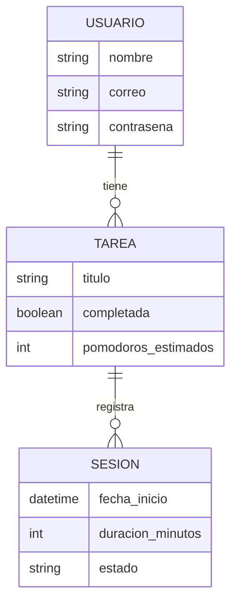

# 3. Diseño de datos, normalización y diccionario

## Modelo entidad-relación (conceptual)

La sesión no lleva usuario. Se llega al usuario a través de la tarea.

## Niveles de abstracción

- **Conceptual:** el diagrama de arriba.
- **Lógico:** las tablas del diccionario, en 3FN.
- **Físico:** los scripts de `sql/esquema.sql`, equivalentes a las migraciones de Laravel y a `database_helper.dart`.

## Normalización

| Forma normal | Cumple | Razón |
| --- | --- | --- |
| 1FN | Sí | Todos los campos son atómicos. `estado` se valida con una lista de valores |
| 2FN | Sí | Las llaves son simples (uuid), así que no hay dependencias parciales |
| 3FN | Sí, después de la migración `2026_10_21_000001` | Antes, `pomodoro_sessions.user_id` dependía de `tarea_id`, que a su vez determina `tasks.user_id`. Se quitó `user_id` de las sesiones |

## Diccionario de datos del servidor

| Tabla | Campo | Tipo | Llave | Restricción | Descripción |
| --- | --- | --- | --- | --- | --- |
| users | id | bigint | PK | NOT NULL | Identificador del usuario |
| users | name, email, password | varchar | | password con hash | Datos de acceso del usuario |
| tasks | id | uuid (texto) | PK | NOT NULL | Identificador de la tarea, generado en el teléfono |
| tasks | user_id | bigint | FK `users.id` | ON DELETE CASCADE | Dueño de la tarea |
| tasks | titulo | varchar(255) | | NOT NULL | Texto de la tarea |
| tasks | completada | boolean | | default false | Estado de la tarea |
| tasks | pomodoros_estimados | smallint sin signo | | default 1 | Pomodoros planeados |
| tasks | updated_at | timestamp | | NOT NULL, indexado | Marca de tiempo del dispositivo para last-write-wins |
| pomodoro_sessions | id | uuid (texto) | PK | NOT NULL | Identificador de la sesión |
| pomodoro_sessions | tarea_id | uuid (texto) | FK `tasks.id` | ON DELETE CASCADE | Tarea trabajada |
| pomodoro_sessions | fecha_inicio | timestamp | | NOT NULL | Inicio de la fase de trabajo, en UTC |
| pomodoro_sessions | duracion_minutos | smallint sin signo | | NOT NULL | Minutos de la fase |
| pomodoro_sessions | estado | varchar(20) | | NOT NULL, solo `completada` | Estado de la sesión |
| pomodoro_sessions | updated_at | timestamp | | NOT NULL, indexado | Marca de tiempo del dispositivo para last-write-wins |
| personal_access_tokens | tokenable_id, tokenable_type | bigint, varchar | | | Dueño del token (polimórfico) |
| personal_access_tokens | token | varchar(64) | | UNIQUE | Hash del token |

## Diccionario de datos del teléfono

| Tabla | Campo | Tipo | Llave | Restricción | Descripción |
| --- | --- | --- | --- | --- | --- |
| tareas | id | TEXT | PK | NOT NULL | Identificador de la tarea |
| tareas | titulo | TEXT | | NOT NULL | Texto de la tarea |
| tareas | completada | INTEGER | | 0 o 1, default 0 | Estado de la tarea |
| tareas | pomodoros_estimados | INTEGER | | default 1 | Pomodoros planeados |
| tareas | updated_at | TEXT | | ISO 8601 en UTC | Marca de tiempo |
| sesiones | id | TEXT | PK | NOT NULL | Identificador de la sesión |
| sesiones | tarea_id | TEXT | FK `tareas.id` | ON DELETE CASCADE | Tarea trabajada |
| sesiones | fecha_inicio | TEXT | | NOT NULL, ISO 8601 en UTC | Inicio de la fase de trabajo |
| sesiones | duracion_minutos | INTEGER | | NOT NULL | Minutos de la fase |
| sesiones | estado | TEXT | | NOT NULL | Estado de la sesión |
| sesiones | updated_at | TEXT | | NOT NULL | Marca de tiempo |
| tareas_eliminadas | id | TEXT | PK | NOT NULL | Tarea borrada que aún no llegó al servidor |
| tareas_eliminadas | eliminada_en | TEXT | | NOT NULL | Momento del borrado |
