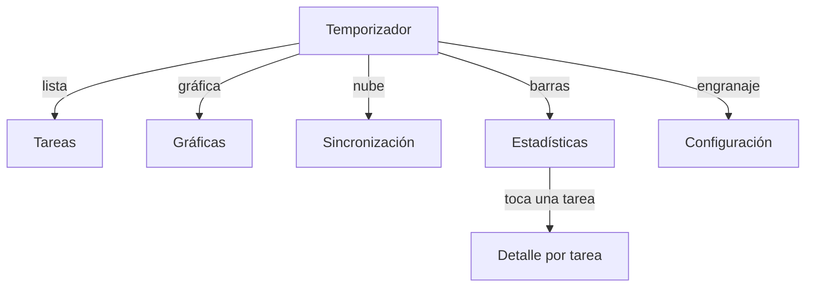

# 4. Diseño de interfaz y heurísticas de usabilidad

## Prototipos de baja fidelidad

Cada cuadro es una pantalla. Los corchetes son botones y los paréntesis son campos.

### Temporizador

```text
+------------------------------------+
|  Pomodoro            [L] [G] [S] [C] [=]
|------------------------------------|
|  (Tarea en la que trabajarás  v)   |
|                                    |
|            [ Trabajo ]             |
|                                    |
|              25:00                 |
|   ==================----------    |
|                                    |
|  [        Iniciar        ]         |
|  (       Pausar         )          |
|  [       Cancelar        ]         |
+------------------------------------+
 L: tareas  G: gráficas  S: sincronizar  C: configuración
```

### Tareas

```text
+------------------------------------+
|  Tareas                            |
|------------------------------------|
|  [x] Estudiar cálculo        [del] |
|  [ ] Leer capítulo 3         [del] |
|                                    |
|                             ( + )  |
+------------------------------------+
```

### Gráficas

```text
+------------------------------------+
|  Gráficas                          |
|  [ Día | Semana | Mes ]           |
|  Total: 150 min                    |
|  Últimos 14 días                   |
|       25                           |
|   ▮ ▮  ▮    ▮▮                     |
|  ▮ ▮ ▮ ▮ ▮ ▮ ▮ ▮ ▮ ▮ ▮ ▮ ▮ ▮ ▮ ▮ ▮ |
|  07 08 09 10 ... 20                |
+------------------------------------+
```

### Sincronización

```text
+------------------------------------+
|  Sincronización                    |
|  (Dirección de la API           )  |
|  (Correo                        )  |
|  (Contraseña                    )  |
|  [      Iniciar sesión        ]    |
|  [      Sincronizar ahora     ]    |
|  Sincronizado: 3 tareas y 5 ses.   |
+------------------------------------+
```

### Configuración

```text
+------------------------------------+
|  Configuración de tiempos          |
|  (Minutos de trabajo      25)      |
|     Recomendado: 15 a 60 min      |
|  (Minutos de descanso      5)      |
|     Recomendado: 3 a 30 min       |
|                                    |
|  [            Guardar          ]   |
+------------------------------------+
```

## Mapa de navegación



Todas las pantallas vuelven al temporizador con el botón atrás.

## Heurísticas de Nielsen

| Heurística | Cómo la cumple la app | Falta |
| --- | --- | --- |
| Visibilidad del estado del sistema | Chip de fase, cuenta regresiva, barra de progreso y gráficas por periodo | Nada |
| Relación entre el sistema y el mundo real | Lenguaje cotidiano y pomodoros de 25 minutos | Nada |
| Control y libertad del usuario | Pausar, cancelar, editar tareas y continuar fuera de rango | Deshacer al borrar una tarea |
| Consistencia y estándares | Material 3 con un color semilla | Estadísticas usa colores fijos |
| Prevención de errores | Límites en configuración, selector bloqueado mientras corre el reloj, confirmación al borrar | Aviso cuando el título queda vacío |
| Reconocimiento antes que recuerdo | Iconos con texto emergente y lista de tareas visible | Nada |
| Flexibilidad y eficiencia | Sin atajos para usuarios frecuentes | Atajos para iniciar y pausar |
| Estética y diseño minimalista | Una acción principal por pantalla | Nada |
| Ayuda para reconocer, diagnosticar y corregir errores | Mensajes como "Selecciona una tarea antes de iniciar" | Nada |
| Ayuda y documentación | Texto de ayuda en campos y pantallas vacías | Manual de usuario |

## Reglas de oro de Shneiderman

| Regla | Cumplimiento | Evidencia | Falta |
| --- | --- | --- | --- |
| Consistencia | Parcial | Material 3 con un color semilla | Colores fijos en Estadísticas |
| Atajos para usuarios frecuentes | No | Sin atajos | Atajos para iniciar y pausar |
| Retroalimentación informativa | Sí | Mensajes de fase, beep y notificación | Nada |
| Diálogos que cierran secuencias | Sí | Confirmación al borrar y aviso de rango | Nada |
| Prevención y manejo de errores | Parcial | Validaciones y selector bloqueado | Aviso de título vacío |
| Reversión de acciones | Parcial | Cancelar en configuración | Deshacer al borrar |
| Control del usuario | Sí | Pausar, cancelar, tiempos propios y opción de continuar | Nada |
| Reducir la carga de memoria | Sí | Una acción por pantalla y chip de fase | Nada |
