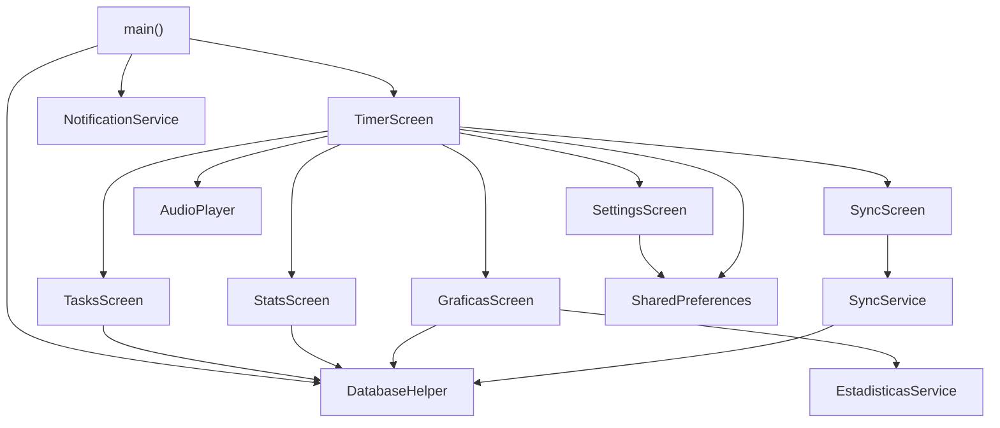

# 1. Procesos y herramientas CASE

## Pseudocódigo del ciclo de fase (app Flutter, `timer_screen.dart`)

```text
INICIO fase(tipo)
  duracion ← si tipo = trabajo entonces minutos_trabajo × 60 si no minutos_descanso × 60
  inicio_reloj ← ahora()
  MIENTRAS restantes > 0 hacer cada segundo:
     restantes ← duracion − (ahora() − inicio_reloj)
  FIN MIENTRAS
  AL PAUSAR: restantes ← duracion − (ahora() − inicio_reloj) y se detiene el reloj
  reproducir beep y mostrar aviso
  SI tipo = trabajo ENTONCES
     guardar sesión (tarea_id, inicio_trabajo, minutos_trabajo, "completada")
     tipo ← descanso
  SI NO
     tipo ← trabajo
  FIN SI
FIN
```

## Pseudocódigo de la sincronización (API, `SyncController::syncData`)

```text
INICIO syncData(payload, usuario)
  validar payload (tasks[], sessions[], tareas_eliminadas[])
  INICIAR transacción
  PARA CADA tarea EN tasks:
     existente ← buscar por id, con bloqueo
     SI existente existe Y (existente.user_id ≠ usuario O tarea.updated_at ≤ existente.updated_at) ENTONCES
        omitidos ← omitidos + 1
     SI NO
        guardar tarea con user_id = usuario y updated_at del dispositivo
  SI alguna sesión apunta a una tarea que no es del usuario ENTONCES
     ERROR 422, se revierte la transacción
  PARA CADA sesión EN sessions: igual que las tareas, con la propiedad verificada por su tarea
  borrar las tareas de tareas_eliminadas que sean del usuario (las sesiones caen por cascada)
  CONFIRMAR transacción
  responder conteos y server_time
FIN
```

## Carta de estructura

Cada rectángulo es un módulo. Las líneas bajan desde quien llama hacia quien es llamado. El recuadro punteado repite un módulo que ya aparece.



## Herramientas CASE

El proyecto no incluía modelos de una herramienta CASE. Los diagramas de este documento están escritos en Mermaid, un lenguaje de texto que se versiona junto con el código. Cada diagrama se traza a una sección de `arquitectura.md` o `datos.md`.
